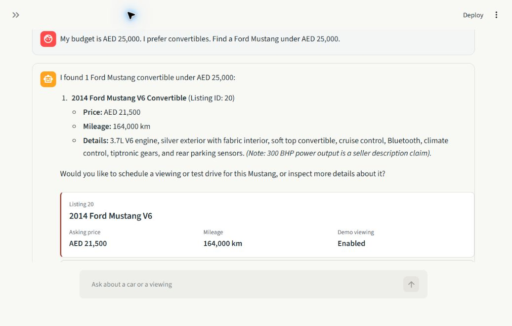
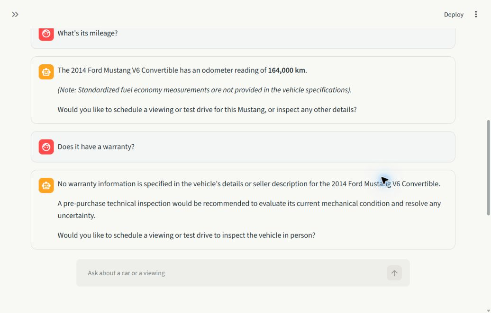
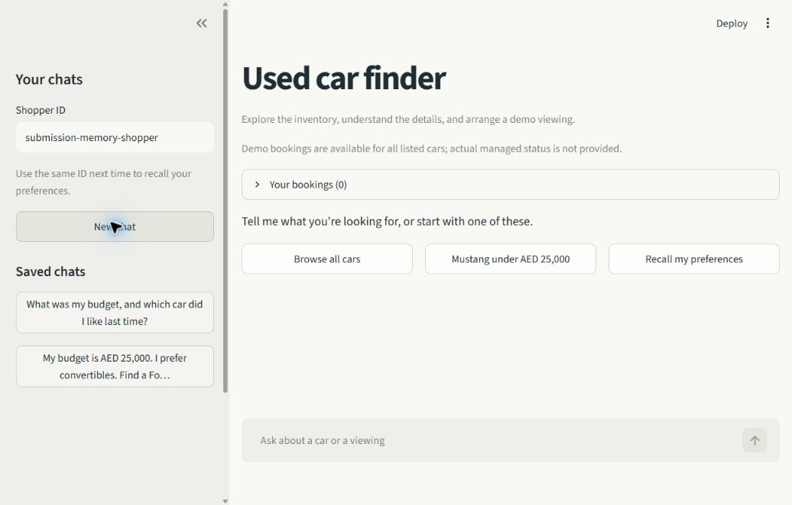
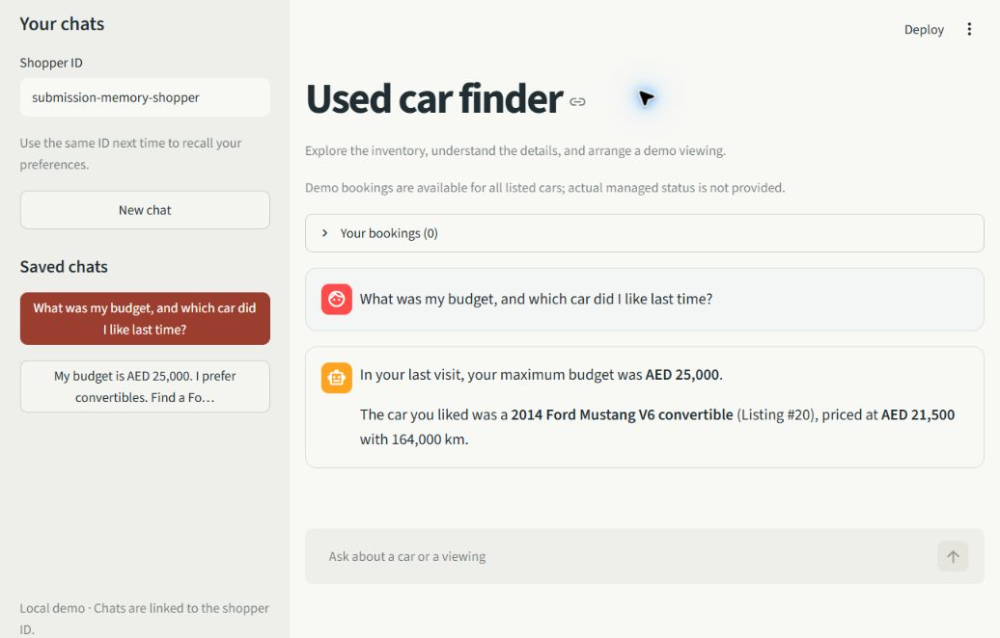

# Used car finder

A FastAPI and Streamlit assistant that uses Gemini to explore 100 used cars, remember shoppers, capture leads, and simulate bookings.

## 1. Quick setup and execution

Requires Python **3.11–3.14**, [uv](https://docs.astral.sh/uv/getting-started/installation/), and a [Google AI Studio API key](https://aistudio.google.com/apikey).

From the repository root:

```shell
uv sync --locked
```

Copy `.env.example` to `.env` (`Copy-Item .env.example .env` in PowerShell, or `cp .env.example .env` on macOS/Linux) and set `GEMINI_API_KEY`.

Start the FastAPI backend:

```shell
uv run uvicorn main:app --host 127.0.0.1 --port 8000
```

In a second terminal, from the same directory, start Streamlit:

```shell
uv run streamlit run app.py --server.address 127.0.0.1 --server.port 8501
```

Open [the chat](http://127.0.0.1:8501) or [the API docs](http://127.0.0.1:8000/docs).

## 2. Why these choices

I chose Streamlit because I had previous experience with it and it provides a browser chat with car cards and saved sessions, without needing to run notebook cells. Gemini's native function calling through the Google Gen AI SDK connects directly to Python functions, so an additional agent framework wasn't needed. For 100 listings, SQLite supports exact filters and searches over listing titles and descriptions. SQLite also keeps preferences and previous inquiries across new chats and restarts, with records that can be checked directly in the database.

## 3. Implementation

Validated tools retrieve inventory and stage changes; one SQLite transaction commits the conversation turn and its updates. Session state holds displayed cars and booking drafts, while shopper preferences persist across chats. Missing listing facts remain unknown. Bookings require review and explicit confirmation. Hours are **Monday–Saturday, 08:00–20:00 Dubai time**; 30-minute slots and making all 100 cars demo-bookable are simulation assumptions. Leads capture price range and needs in **`runtime/leads.csv`**, even without a booking.

For further improvements I’d add semantic search alongside the existing filters, retrieve relevant history beyond the last 24 exchanges, and reduce model calls for faster replies. I’d also test more ambiguous follow-ups and messages containing multiple requests.

## 4. Demo screenshots

Screenshots replay the saved responses from a verified live Gemini run; the original [record](evidence/submission-demo.md) includes new-session checks.

### Demo 1: inventory exploration and follow-ups

Search for a Ford Mustang under AED 25,000 while stating a convertible preference.



Use “its” and “it” to ask about the same car's mileage and warranty.



### Demo 2: memory in a completely new chat

Keep the same **Shopper ID** and click **New chat**.



The recorded new-session conversation recalls the earlier budget and liked car.


