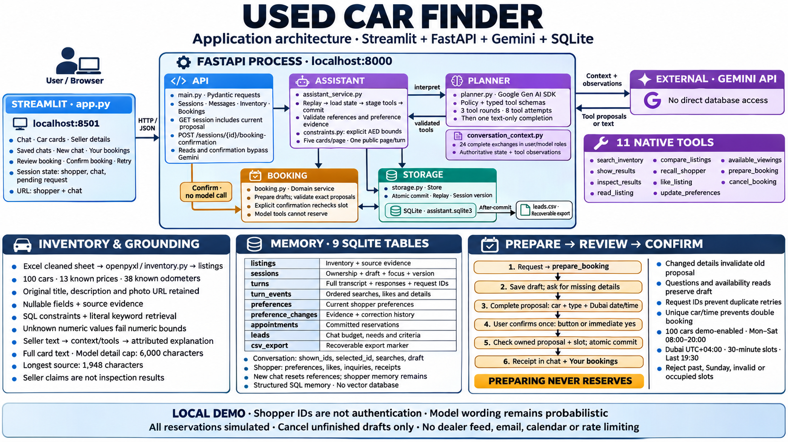

# Implementation details

Start with the [setup instructions](../README.md). The [submission demo](../evidence/submission-demo.md) records the required same-session and fresh-session conversations plus lead capture and booking. [Validation](../VALIDATION.md) identifies the verified source snapshot, checks, and limitations.

## Using the client

Open [the chat](http://127.0.0.1:8501). The sidebar's **Saved chats** restores messages and conversation state. URL parameters `shopper` and `chat` preserve the selection across refreshes. **New chat** starts with no active car, result page or booking draft while retaining the shopper's preferences and prior inquiries. An unfinished draft remains in its original saved chat. Reuse the same **Shopper ID** in another browser to access their saved chats.

Ask for a viewing or test drive in chat. Once the details are complete, **Review booking** appears below the latest messages, immediately above the composer, with the exact car, appointment type and date/time in **Dubai time (UTC+04:00)**. Nothing is reserved yet. Click **Confirm booking** once, or send a standalone confirmation such as “yes”, “yes confirm it” or “confirm the booking” immediately after the proposal. Messages that change details, ask a question or include another task are not treated as confirmation. The button remains available if you ask vehicle questions first. Changing a detail creates a revised proposal; historical proposals have no confirmation buttons. A failed confirmation can be retried with the same request ID.

**Your bookings**, above the chat, shows the current shopper's saved demo appointments across all chats. Each confirmed receipt includes a booking reference, car, appointment type and Dubai date/time. The same receipt appears in the conversation where the booking was made. It remains available after **New chat** or a browser refresh; **Refresh bookings** reloads the saved records. A chat sentence alone is not a reservation. Collecting details and awaiting confirmation have neutral progress messages; rejected attempts and historical unexecuted booking claims show **“No booking was saved for this message.”** No dealership is contacted.

Results appear five at a time. **Show me more** advances; **show those again** repeats the current page. New or refined searches restart pagination. **The second one** refers to the displayed page, never to an incidental internal lookup. A zero-match search records the attempted filters while retaining the previously discussed car and last displayed results.

## Architecture and memory

Streamlit supplies chat, cards and saved-session controls directly in Python. The Gemini SDK supports the bounded tool loop without an orchestration framework. With 100 cars, SQL provides exact constraints and literal text retrieval, while SQLite makes preferences, evidence and booking transactions inspectable. A vector database is unnecessary for the required exact memory and inventory operations.

`GeminiPlanner.run_turn()` uses native function calling through the Google Gen AI SDK. It can answer a greeting directly or perform several validated tools before composing one response. For example, “I like this car; what is its price?” can record the like and read the price in one turn. Pydantic validates each call, and the model receives backend observations before continuing. The loop is bounded to three tool rounds and eight calls. At the limit, one separate text-only composition request has no tool declarations. If composition fails, a bounded fallback uses available backend outcomes; no further actions execute during that step. Normal composition preserves mixed requests, such as an answer about mileage alongside booking progress.

`conversation_context.py` transports the latest **24 saved exchanges** as complete role-labelled user and assistant messages; individual replies are not clipped to 650 characters. Structured current state and action records are supplied separately. The model receives Dubai's current date/time, current cards, personal preferences, a booking draft and committed receipts. Third-party shopping boundaries can narrow the supplied dialogue. The entire transcript remains stored even when older exchanges are outside this recent-context window.

Each turn can publish one result page, including a zero-match page. Internal research may retrieve other cars, but a later tool cannot replace that requested page with an unsolicited alternative or erase its filters. Another shopper message can explicitly show those alternatives. Structured references from displayed results, saved history, pending bookings and tool observations remain valid independently of which car is currently selected.

Before the model runs, a conservative ingestion pass recognizes explicit personal budgets and literal make, model, body-style and color preferences. It uses the same evidence validation as model-proposed updates, rejects ambiguous or unsupported claims, and exposes accepted values in the staged context. Thus “My budget is AED25,000. I prefer convertibles. Show me a Mustang” retains the preferences even if Gemini chooses only a search. Freeform needs still use model-proposed updates. These automatic updates share the turn's atomic commit and rollback.

`lead_collection` reports whether the **current inquiry** has a recorded price bound and vehicle needs, lists missing fields, and supplies one suggested collection question. Initial model context and tool observations carry this state separately from the shopper's lasting profile. The model is instructed to gather missing information after browsing or preference updates, without repeating unanswered questions or interrupting factual answers, recall, or booking confirmation. Short answers to an immediately preceding budget/needs question are interpreted in that context and accepted only with supporting text. An incomplete lead never blocks browsing or booking. Completeness means both kinds of information were recorded; freeform interpretation remains model-dependent.

`Assistant.respond()` stages tool effects in a per-turn workspace. Later tools see earlier preference changes, search results and likes. One SQLite transaction saves the response, ordered `turn_events`, preferences and conversation state. **No model tool can reserve an appointment.** `prepare_booking` calls the domain service in `booking.py` to collect and validate a durable draft, then returns a complete proposal requiring final confirmation. Searches and read-only availability checks do not discard that draft.

`Assistant.confirm_booking()` accepts an exact current proposal ID through the dedicated HTTP route, without calling Gemini. An immediate exact affirmative after a proposal uses the same path. `booking.py` revalidates the proposal and slot; Store atomically writes the confirmation turn and appointment and clears the draft. A confirmed receipt and stable booking reference come from that actual appointment row. A stale proposal, invalid slot or failed transaction cannot produce a receipt. Request IDs support safe retries, session versions detect concurrent changes, and a unique car/time constraint prevents double bookings. Provider errors that propagate without a usable fallback leave staged chat changes uncommitted. The CSV is rebuilt from committed lead data and can recover after a file-write failure.

Memory combines structured records and recent conversational context, without a vector database. The full transcript is stored separately from these precise conversation references:

| State | Meaning |
|---|---|
| `retrieved_search` | Latest search result set, including an internal lookup that did not display cards. |
| `active_search` | Public search filters, ordered candidates and pagination cursor, including a valid empty attempt. |
| `shown_ids` / `selected_id` | The displayed card order and the car in conversational focus. Reading comparison evidence does not automatically change focus. |
| `last_results` | Last nonempty displayed search page, retained for redisplay after an unsuccessful search. |
| `shopping_context` / `pending_booking` | Whose inquiry is being discussed, and a booking draft in `collecting` or `awaiting_confirmation` state. Availability is read-only. |

Explicit preferences, supporting turns, corrections and personal likes belong to the shopper across chats. Third-party shopping context persists across follow-ups without adopting another person's preferences. “Last visit” means the most recently active other chat. Fresh chats inherit personal memory but no current car, displayed results or unfinished booking. Additive migrations preserve older records.

Recall supplies separate scoped collections of preferences and liked cars, with counts and completeness flags, alongside a bounded list of recent inquiries. A recent search for someone else cannot hide an earlier personal like. The model must distinguish a complete empty collection from an item missing in a truncated history.

Inventory questions use structured fields and missing-data coverage from backend tools. `compare_listings` calculates exact signed and absolute price/odometer differences for up to five cars; unknown measurements never become zero. Gemini composes the explanation from those observations. “What does V6 mean?” can explain the general concept while distinguishing it from the dataset's trim label. Unknown facts remain unknown, and seller wording remains a claim rather than an inspection result.

The backend checks explicit AED price bounds in the latest message before displaying search results or synchronizing the lead. Recognized bounds and inclusive/exclusive limits override conflicting model arguments; an internal lookup cannot bypass them when presenting results. Ambiguous currencies or bounds require clarification before changing the public search.

## Inventory and booking assumptions

Startup imports the **cleaned dataset** sheet's 100 listings with openpyxl, preserving IDs, make, model, trim and year. The two sheets contain different samples and are not combined. Conservative extraction finds 13 total asking prices and 38 numeric odometers with source excerpts. Numeric bounds exclude unknown values; tools report candidates with missing required data separately. Sorting keeps unknown values after known ones rather than deleting those cars. Monthly payments are not total prices; warranty limits and service intervals are not odometer readings. The dataset supplies no standardized fuel-economy measurements.

SQLite retains original titles/descriptions alongside derived fields and their evidence excerpts. Literal keyword search examines normalized title and description terms; detailed listing tools and the displayed/selected-car context supply seller text to Gemini for grounded explanations. Detailed fact observations and the initial displayed/selected-car context cap descriptions at 6,000 characters; search cards retain the full text. The longest supplied description is 1,948 characters, so none is truncated in this dataset.

**All 100 cars in the supplied inventory are enabled for simulated bookings.** This is an explicit demo assumption: the workbook has no managed-status or appointment feed, so eligibility does not establish that any car is actually managed by dubizzle. **30-minute slots** are also an implementation assumption. Hours are **Monday–Saturday, 08:00–20:00 Dubai time**, with starts through **19:30**. The backend rejects nonexistent listings, past dates, Sundays, invalid times and occupied slots. Booking details can span turns and survive restarts, but even a fully specified initial request must be reviewed and confirmed once. Availability inquiries reserve nothing. Cancellation stops an **unfinished draft**; confirmed appointments cannot be canceled. No dealership is contacted.

A complete proposal identifies the car, appointment type and exact date/time. Missing components trigger clarification rather than a reservation. The backend normalizes unambiguous date/time phrases against the current Dubai clock: “this Saturday” means the nearest Saturday, while an explicit calendar date remains that date. Conflicting weekday/date combinations and ambiguous “next Saturday” requests require clarification. The review card exposes the interpreted date before confirmation. A bare “11 am” after cancellation cannot authorize a reservation.

The assignment requires prebooked viewings/test drives during the stated hours and local CSV lead capture; it does not prescribe a receipt screen, calendar or email. **Your bookings** and the persistent confirmation receipt are implementation choices that make the simulated transaction verifiable. Historical chat text is preserved, while receipt retrieval checks the actual appointment records so an old unexecuted confirmation cannot appear as a saved booking.

## API, local data and checks

- [Interactive API docs](http://127.0.0.1:8000/docs) describe inventory filters, listing details, sessions, messages and bookings. [Health](http://127.0.0.1:8000/health) includes the imported listing count.
- `POST /sessions` takes `user_id`; `GET /sessions?user_id=...` lists saved chats. `POST /sessions/{session_id}/messages` takes `user_id`, `message` and optional `request_id`. Reuse the same ID and message when retrying. `GET /sessions/{session_id}?user_id=...` reads history plus the current `booking_proposal`, without another Gemini call.
- `POST /sessions/{session_id}/booking-confirmation` takes `user_id`, `request_id` and the exact current `proposal_id`; it never calls Gemini. A proposal contains `status=awaiting_confirmation`, `proposal_id`, `listing_id`, `car_label`, `starts_at`, `kind` and `session_id`. Preparation leaves `booking` null. Confirmation returns a committed receipt, or HTTP 409 for a stale proposal or unavailable slot. Retrying the same request/proposal returns the original receipt; changing the proposal under an existing request ID is rejected. The client retains this ID for **Retry confirmation** and recovers a committed response from saved history after a timeout.
- `GET /bookings?user_id=...` lists committed appointments belonging to that shopper across sessions, without calling Gemini. Each receipt contains `booking_id`, `status` (`confirmed`), `listing_id`, `car_label`, `starts_at`, `kind` and `session_id`. Successful chat responses and saved history expose the same receipt in their `booking` field. These IDs scope this local demo's records; they are not authentication.
- Run `uv run pytest -q` for offline tests of inventory, native tool protocol, staged execution/rollback, memory, pagination, bookings, leads, migration, API and client. Scripted models and planner callbacks isolate these contracts; they do not establish live model accuracy. See `VALIDATION.md` for evidence status.
- The first run creates `runtime/assistant.sqlite3` and `runtime/leads.csv`. The CSV captures a chat's budget and needs even without a booking. New searches synchronize search-derived criteria and price bounds with the effective filters; removed filters do not linger. Explicit preference updates can patch the lead, and pagination does not overwrite later corrections. Personal preference memory remains separate from the current inquiry.
- Set `CAR_ASSISTANT_DATA_DIR` for a separate demo database, or `API_BASE_URL` in the client environment for another backend port.

## Scenarios to try

| Scenario | Messages and expected behavior |
|---|---|
| Grounded details and explanations | “Find a Ford Mustang under AED 25,000.” → listing 20, AED 21,500. “Tell me more.” → listing overview. “What does V6 trim mean?” → an explanation. “Its mileage and warranty?” → 164,000 km; warranty unspecified. |
| Pagination and comparison | In a new chat, “What cars are available?” then “Show me more.” → distinct pages. “What year is the second one?” → the current page's second car. “Compare listing 20 with listing 12.” → verified fields and an AED 13,500 price difference. |
| Unknown data and preserved context | “Show Nissan cars, cheapest first.” → five cars with unknown prices, not zero cars. Ask about fuel economy → no invented figures. “Show those cars again.” → the same page. |
| Personal memory versus another inquiry | “My budget is AED 25,000.” then “Actually, my budget is AED 30,000.” Then “New search for my brother: Toyota cars, any model or color, with no price limit.” Start **New chat** and ask “What is my budget?” → AED 30,000. The brother's search remains inquiry history. |
| Booking across turns | “Book a test drive of listing 20.” → asks for missing details. Supply a future Monday's exact calendar date, ask “What's its mileage first?”, then say “10 am Dubai time.” → retains the draft and shows **Review booking**, without reserving. Click **Confirm booking** → a saved appointment with a reference. Open **Your bookings**, then start **New chat**: the appointment remains visible. Choose another slot if occupied. |
| Availability and cancellation | “Which slots are available for listing 20?” then a future Monday date → shows availability without booking. Start an incomplete booking and say “Cancel the unfinished booking.” → clears that request. |

## Limits and next steps

This is a **local, single-machine demo**. Shopper/session IDs scope lookups but are **not authentication**, including in URLs. Bind services to localhost. Messages and relevant context/listing information are sent to Gemini; avoid real personal information in demo data.

Unrelated and competitor requests are redirected. Intent recognition and explanations depend on the model; backend validation controls persistence and bookings. There is no rate limiting or bulk-extraction protection; pagination does not prevent scraping. Future work includes authenticated ownership, request limits, real inventory/appointment feeds, retention controls and broader provider evaluations. Semantic recall is a future experiment; exact preferences and transaction state should remain structured.

A chat request can still fail because of provider availability or quota when no usable backend outcome has been obtained. The client keeps the message and offers **Retry message** with the same request ID. Reaching the tool budget ends further tool execution and uses the bounded completion path described above. Confirming a displayed proposal does not depend on the model. Unhandled failures leave staged work uncommitted, and a confirmation response lost after a successful commit is replayed rather than booked twice.
